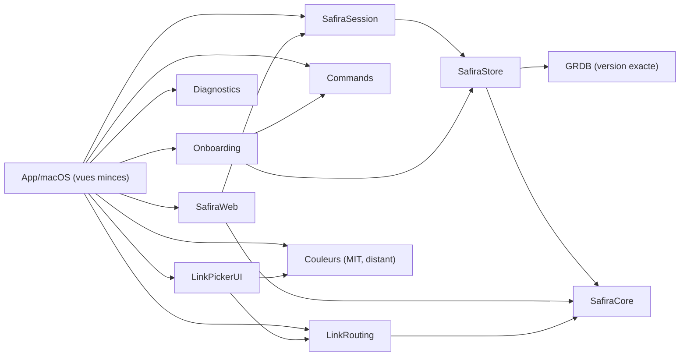

# Safira : architecture de la v1

Statut : proposition à valider par Antonin (scope-v1.md §11). Rédigé le 2026-11-03 sur macOS 27.0.1, Xcode 27.1 (Swift 6.4, SDK macOS 27.0), Apple M4.

Ce document est une architecture. Il ne contient aucun code produit. Le périmètre de `scope-v1.md` fait foi : ce document ne rouvre aucune décision de produit. Il signale les contradictions et les trous qu'il y trouve (§0.2 et §12).

> **Mise à jour du 2026-11-03 (validation par Antonin).** Les questions du §12.2 sont tranchées et douze décisions ont modifié ce document ; elles sont listées à la fin (§13) et dans `scope-v1.md` §13. En cas de désaccord entre le texte ci-dessous et le §13, **le §13 fait foi**. Les points les plus visibles : clés de localisation anglaises (pas la convention d'Oisillon du §9.6), ⇧⌘T en mémoire seulement (§4.1), aucune présélection dans le picker (§5.5), journal du picker en opt-in limité à l'hôte et au Profile (§5.5), état d'onglet réduit à l'adresse pour les pages avec mot de passe ou POST (§3.6).

Légende :

- **[É]** établi, avec la source ;
- **[D]** déduit, avec le raisonnement ;
- **[NV]** non vérifié.

Conventions de sources :

- « SDK 27 » = en-têtes et interfaces Swift du SDK macOS 27.0 d'Xcode 27.1, lus en local (`MacOSX27.0.sdk/System/Library/Frameworks/WebKit.framework/Headers/` et `…/Modules/WebKit.swiftmodule/arm64e-apple-macos.swiftinterface`, `_WebKit_SwiftUI.framework`).
- « Oisillon » = le dépôt privé de l'app mail de l'auteur, commit `4d2428c` (2026-11-03).
- « ZenPicker » = le prototype de picker de l'auteur (`ZenPicker.swift`, hors de ce dépôt).
- « Recherche » = `docs/research-tab-discarding.md` ; « Banc » = `docs/conformance-bench-plan.md`.
- Ora et Re-Arc ont été lus par l'API GitHub et des pages brutes, à travers un outil qui résume les fichiers. Ces affirmations sont [É] pour l'existence du fichier cité, mais le détail d'implémentation peut être approximatif. Aucun code n'en a été copié.

---

## 0. En bref

### 0.1 Décisions recommandées

| # | Sujet | Recommandation | Section |
|---|---|---|---|
| 1 | Pile UI | **Hybride, AppKit au-dessus** : cycle de vie AppKit, `NSWindow` unique, menus et raccourcis par la chaîne de répondeurs, `WKWebView` dans une vue AppKit ; SwiftUI pour le contenu (sidebar, command bar, réglages, onboarding, panneau du picker) dans des `NSHostingView`. Pas de `WebView`/`WebPage` SwiftUI : il leur manque `interactionState`, `window.open`, `WKDownload` et `WKPreferences` [É SDK 27]. | §1 |
| 2 | Modules | Un paquet local `SafiraKit` sur le modèle d'OisillonKit : logique testée par swift-testing, vues minces. Le profil est un **contexte** (`ProfileContext`) qui possède seul son data store, sa base et ses téléchargements ; aucune API ne prend deux profils. | §2 |
| 3 | Couleurs | Dépôt séparé MIT consommé en dépendance SwiftPM distante, **version exacte**. Le solveur de lisibilité d'Oisillon doit être **généralisé** : il est réglé sur la colonne de liste d'un client mail. | §2.4 |
| 4 | Stockage | **GRDB/SQLite**, comme Oisillon. **Une base par profil** dans le dossier du profil, plus une base d'app. Pas de SwiftData. | §3 |
| 5 | Onglets | Une `WKWebView` par onglet vivant, créée paresseusement, possédée par un registre hors des vues ; `inactiveSchedulingPolicy = .suspend` explicite ; l'état de l'onglet est une machine à états prête à recevoir l'état « Libéré » de la Recherche. | §4 |
| 6 | Picker | Port du code de ZenPicker dans l'app : règles, réécritures vers les apps natives, panneau du notch. Le panneau devient **non modal** (`runModal` bloquerait la boucle principale du navigateur). La cible d'une règle est un profil (et un Space en option), plus une app. | §5 |
| 7 | HTTPS d'abord | `WKWebpagePreferences.preferredHTTPSNavigationPolicy = .userMediatedFallbackToHTTP` (macOS 15.2, « shows a warning page on failure ») pour les adresses saisies sans schéma, avec une page de repli propre à Safira si WebKit ignore la politique [É SDK 27]. | §6 |
| 8 | Bac à sable | **App Sandbox activée dès la coquille**, avec le runtime durci. Sortir du bac à sable plus tard est facile ; y entrer impose une migration de conteneur [D]. Coût : la recherche de l'identifiant d'équipe Slack du picker. **À valider** (Q1). | §8.2 |
| 9 | Distribution | XcodeGen (comme Oisillon), signature, notarisation et DMG **en local** par un script `OK:/FAILED:` ; CI publique sans secrets (build et tests seulement) ; Sparkle 2.10.1 avec `SUEnableAutomaticChecks = NO`. | §8 |
| 10 | Spikes | Sept spikes avant le premier jalon, dont la mesure A0 rapide (§11.2). | §11 |

### 0.2 Contradictions et trous trouvés dans scope-v1.md

1. **Cibles du module de couleurs** : scope-v1.md §7 annonce « macOS 27 et iOS 26 (cibles d'Oisillon) ». Or Oisillon vise **macOS 26** et iOS 26 (`project.yml` l. 6-8 ; `docs/architecture.md` l. 269 : « Le passage à macOS 27 […] a été défait par `363f256` ») [É Oisillon]. Pour qu'Oisillon puisse l'adopter, le module doit viser macOS 26. Safira, en macOS 27, le consomme sans difficulté [D].
2. **« Une seule fenêtre »** a au moins quatre exceptions inévitables : la fenêtre privée (scope §3), les popups `window.open` avec dimensions (OAuth), le panneau du picker, et l'inspecteur web (§4.6). Le document propose un traitement pour chacune (§1.4) ; Antonin doit l'accepter (Q2).
3. **Web Inspector « isInspectable »** : en API publique, `isInspectable` rend la vue inspectable **depuis le menu Développement de Safari**. L'inspecteur dans l'app passe par une SPI. Ora l'active par KVC sur `developerExtrasEnabled`, une SPI ([Ora, résumé](https://github.com/the-ora/browser)). La v1 ouvrira donc l'inspecteur dans Safari [D] (Q5).
4. **Restauration « les épinglés se rechargent »** : de tous les profils et Spaces, ou du profil actif seulement ? Cela fixe la RAM au lancement et les **requêtes réseau au lancement**, qui ne seront donc pas « vides » (§6.4, Q4).
5. **« Rien n'est partagé entre profils, sauf l'apparence »** : le picker (règles, journal d'apprentissage) et le journal de diagnostic sont par nature au-dessus des profils. Il faut les déclarer comme exceptions (§5.5, §6.2).
6. **Liste des choix « par défaut »** (Q37) : scope-v1.md n'en donne pas l'inventaire complet. Le §7.2 en propose un, à compléter par Antonin.
7. **Notifications web** : aucune API publique sur macOS dans le SDK 27 (rien dans `WKUIDelegate.h`) [É SDK 27, par absence]. Slack ou Gmail web n'enverront pas de notifications. Ce n'est pas dans le périmètre, mais l'usage quotidien le remarquera.
8. **Navigation sécurisée** : `WKPreferences.fraudulentWebsiteWarningEnabled` vaut YES par défaut [É SDK 27, `WKPreferences.h` l. 50-53]. C'est un comportement « par défaut » avec une composante réseau système, absent de scope-v1.md (§6.4).
9. **Recherche, point ouvert 11** (rattachement des process WebKit à l'app) : Oisillon le résout déjà dans un script de mesure avec `responsibility_get_pid_responsible_for_pid` (`scripts/memory-profile.sh` l. 66-75) [É Oisillon]. Ce symbole n'est pas documenté ; il convient pour un outil de mesure, jamais dans l'app [D].
10. **Bug WebKit 316948** (pool de connexions réutilisé après un changement de `proxyConfigurations`) : RESOLVED FIXED par 324143@main le 2026-10-19 ; signalé sur iOS ([bugs.webkit.org](https://bugs.webkit.org/show_bug.cgi?id=316948)) [É]. Sa présence dans macOS 27.x est [NV]. La règle « configuration réseau avant la création du data store » reste donc nécessaire.

---

## 1. Pile UI

### 1.1 Ce que SwiftUI offre pour le web sur macOS 27, et ce qui manque

Depuis macOS 26, WebKit fournit `WebPage` (observable) et la vue SwiftUI `WebView` [É SDK 27, `WebKit.swiftinterface` l. 486-490 ; `_WebKit_SwiftUI.swiftinterface` l. 91]. Comparaison avec ce dont Safira a besoin :

| Besoin | `WKWebView` | `WebPage` / `WebView` | Source |
|---|---|---|---|
| Data store par profil | `configuration.websiteDataStore` | `WebPage.Configuration.websiteDataStore` | [É SDK 27] |
| Contrôleur d'extensions (porte ouverte) | `webExtensionController` | `Configuration.webExtensionController` | [É SDK 27] |
| `interactionState` (restauration, libération) | oui, macOS 12 | **absent** | [É SDK 27, par absence dans l'interface Swift] |
| `window.open`, `target=_blank` | `WKUIDelegate createWebViewWith…` | **absent** | idem |
| Téléchargements `WKDownload` | délégué complet | seulement `NavigationAction.shouldPerformDownload` | idem, l. 347 |
| `WKPreferences` (`inactiveSchedulingPolicy`, plein écran d'élément, navigation sécurisée) | oui | **pas de `preferences`** dans `WebPage.Configuration` | idem, l. 130-160 |
| Permissions caméra et micro | `requestMediaCapturePermissionFor` | `DeviceSensorAuthorization` | [É SDK 27] |
| Géolocalisation | `requestGeolocationPermissionFor` (**macOS 27**) | non exposé | [É SDK 27, `WKUIDelegate.h` l. 302] |

**Conclusion [D]** : `WebPage` ne suffit pas pour un navigateur. La restauration paresseuse (scope §4), la libération future (Recherche §4) et les popups l'excluent. Safira utilise `WKWebView`.

### 1.2 Alternatives pour la fenêtre

| Option | Pour | Contre |
|---|---|---|
| **A. Tout SwiftUI** (`App`, `Window`, `NSViewRepresentable` pour la `WKWebView`) | Itération rapide, aperçus | Le cycle de vie SwiftUI recrée les représentables quand l'identité change : une `WKWebView` recréée recharge la page [D]. Ora montre `.id(tab.id)` sur la vue de contenu ([`BrowserWebContentView.swift`](https://raw.githubusercontent.com/the-ora/browser/main/ora/Features/Browser/Views/BrowserWebContentView.swift)) et plusieurs bugs de routage de raccourcis (A ci-dessous). Les événements Apple `GURL` doivent être posés avant `applicationDidFinishLaunching` (ZenPicker l. 383-387) : faisable avec un adaptateur, mais moins direct. |
| **B. Tout AppKit** | Contrôle total du focus, des menus et des panneaux | Beaucoup de code pour la sidebar (listes, glisser-déposer, animations) |
| **C. Hybride, AppKit au-dessus** (recommandé) | AppKit tient la fenêtre, le premier répondeur, les menus, la `WKWebView` ; SwiftUI dessine le contenu | Deux mondes à faire coexister (focus entre `NSHostingView` et vues AppKit) |

Re-Arc a choisi C : `NSWindowController` et `NSWindow` qui tiennent une `NSHostingView` ([`BrowserWindowController.swift`](https://raw.githubusercontent.com/Re-Arc/re-arc-mac/main/Packages/ReArcKit/Sources/AppShell/BrowserWindowController.swift)) [É]. Ora est SwiftUI d'abord, avec des cales AppKit ([`OraApp.swift`](https://raw.githubusercontent.com/the-ora/browser/main/ora/App/OraApp.swift)) [É].

**Pièges documentés par Ora**, presque tous dans le routage des raccourcis [É, issues] :

- ⌘W fermait la fenêtre au lieu de l'onglet ([#144](https://github.com/the-ora/browser/issues/144), [#202](https://github.com/the-ora/browser/issues/202)) ;
- ⌘T focalisait la barre d'adresse au lieu de la command bar ([#40](https://github.com/the-ora/browser/issues/40)) ;
- ⌘L ne marchait plus quand la barre d'outils était masquée ([#119](https://github.com/the-ora/browser/issues/119)) ;
- ⌘Z restaurait un onglet au lieu d'annuler une frappe ([#196](https://github.com/the-ora/browser/issues/196)) ;
- la sidebar ouverte au survol fermait les menus ([#97](https://github.com/the-ora/browser/issues/97)) ;
- un double-clic dans la page redimensionnait la fenêtre ([#141](https://github.com/the-ora/browser/issues/141)).

Re-Arc note en commentaire que la vue d'hébergement SwiftUI intercepte le sélecteur `toggleSidebar(_:)`. Il renomme donc son action et intercepte ⌃Tab dans `sendEvent` ([`BrowserWindowView.swift`](https://raw.githubusercontent.com/Re-Arc/re-arc-mac/main/Packages/ReArcKit/Sources/AppShell/BrowserWindowView.swift)) [É, lu via résumé].

**Recommandation : C** [D]. Ces bugs viennent tous de commandes portées par SwiftUI. Avec C, chaque commande est un `NSMenuItem` dont l'équivalent clavier est tiré du registre de commandes (le modèle `Commands` d'Oisillon : « Tout ce qui affiche ou lit une touche passe par les bindings : menus […] », `docs/design/shortcuts.md` l. 30) [É Oisillon].

### 1.3 Composants

| Composant | Technologie | Notes |
|---|---|---|
| Cycle de vie | `NSApplicationDelegate`, sans `App` SwiftUI | Gestionnaire `GURL` posé dans `applicationWillFinishLaunching` (ZenPicker l. 383-387) [É] |
| Fenêtre | `NSWindow` (barre de titre transparente, `fullSizeContentView`, onglets natifs désactivés) et `NSWindowController` | Comme Re-Arc [É] |
| Zone web | `TabHostView` (NSView) : contient **la** `WKWebView` sélectionnée, l'échange à la sélection et rend le premier répondeur s'il était dans la page | Les vues sont possédées par un registre (§4.1), jamais par SwiftUI. Ora et Re-Arc font tous deux cet échange avec reprise du focus [É] |
| Sidebar | SwiftUI dans une `NSHostingView` ; modèles `@Observable` sur le main actor | Listes, dossiers, glisser-déposer, épinglés |
| Mode compact | La même `NSHostingView` passe en surcouche ; l'apparition au bord gauche se détecte par une `NSTrackingArea` AppKit, pas par `onHover` | Évite le piège Ora #97 [D] |
| Command bar | Surcouche dans la fenêtre : champ AppKit (`NSTextField`), liste des résultats en SwiftUI | Le focus clavier d'un champ SwiftUI dans une `NSHostingView` est le point le moins prévisible [D] ; le champ AppKit se pilote par `makeFirstResponder` |
| Menus et raccourcis | `NSMenu` construit depuis le registre `Commands` et les presets Zen, Arc et Safari | Port du modèle `ShortcutSet` d'Oisillon (`Commands/ShortcutSet.swift`) : un jeu = un fichier de données, surcharges utilisateur à part [É Oisillon] |
| Panneau du picker | `NSPanel` non activant, `NSHostingView`, forme du notch | Code de ZenPicker l. 234-375 [É] |
| Réglages, onboarding, téléchargements | SwiftUI hébergé | — |

### 1.4 Les exceptions à la fenêtre unique

| Cas | Proposition | Raison |
|---|---|---|
| Fenêtre privée | Une `NSWindow` à part par fenêtre privée, sans sidebar de Spaces | scope §3 [É] |
| Popup `window.open` avec `windowFeatures` (OAuth, paiement) | Petit `NSPanel` flottant, rattaché à l'onglet ouvreur, fermé par `webViewDidClose` | Une connexion OAuth attend un `window.opener` vivant. Ora renvoie `nil` et ouvre un onglet, et reçoit des plaintes de connexion Google ([#70](https://github.com/the-ora/browser/issues/70), [#172](https://github.com/the-ora/browser/issues/172)) [É] |
| `target=_blank` sans dimensions | Nouvel onglet du même Space | Comportement Arc et Zen [D] |
| Inspecteur | Fenêtre de Safari (§0.2, point 3) | API publique seulement |

### 1.5 Pièges connus de `WKWebView` dans une app Swift 6

- **Raccourcis contre page web** : une page (Google Docs, Figma) peut vouloir ⌘K ou ⌘L. L'ordre entre `performKeyEquivalent` de la `WKWebView` et le menu principal n'est pas documenté. C'est le **spike S1** [NV].
- **Cycles de rétention** : un `WKScriptMessageHandler` retient sa vue. Il faut un mandataire faible et `removeAllScriptMessageHandlers()` à la fermeture (Recherche §1.5) [D, fil de forum].
- **Process tué** : `webViewWebContentProcessDidTerminate` est le seul signal public [É SDK 27]. On recharge alors avec l'état sauvegardé.
- **Concurrence** : les délégués WebKit sont annotés `WK_SWIFT_UI_ACTOR` (main actor) dans le SDK 27 [É SDK 27, par exemple `WKNavigationDelegate.h` l. 98]. Les modèles d'onglet sont donc `@MainActor` ; la base et le journal tournent hors du main actor (acteurs), comme dans Oisillon (`CLAUDE.md`, « Concurrence stricte Swift 6 ») [É Oisillon].

---

## 2. Découpage en modules

### 2.1 Proposition

Un paquet local `Packages/SafiraKit` (swift-tools-version 6.2 ou plus, donc mode Swift 6 strict, comme `OisillonKit/Package.swift` l. 1-4) [É Oisillon]. L'app `App/macOS` reste mince : elle lit les modèles et appelle les contextes, jamais la base ni WebKit directement (règle d'Oisillon, `CLAUDE.md` l. 22-24) [É].

| Module | Contenu | Dépend de | Lie WebKit ? |
|---|---|---|---|
| `SafiraCore` | Types valeur `Sendable` : `ProfileID`, `SpaceID`, `TabID`, `Profile`, `Space`, `Folder`, `TabRecord` ; résolution de la saisie (URL, recherche, HTTPS d'abord, en logique pure) ; modèle de préférences ; `PlatformServices` (protocoles) | — | non |
| `SafiraStore` | GRDB : `AppDatabase` (profils, réglages d'app), `ProfileDatabase` (Spaces, onglets, historique FTS5, téléchargements, permissions), migrations | Core, GRDB | non |
| `SafiraSession` | État de navigation d'un profil : Spaces, ordre, sélection, épinglés, dossiers ; machine à états d'onglet (§4.2) ; restauration paresseuse. Parle à WebKit par un protocole `WebPageHandle` simulé en test | Core, Store | non |
| `SafiraWeb` | `ProfileWebContext` : création du data store, fabrique de `WKWebViewConfiguration`, délégués de navigation et d'interface, téléchargements, permissions, emplacements pour le contrôleur d'extensions et la configuration réseau | Core, Session | **oui** |
| `Commands` | Registre des commandes, presets Zen, Arc et Safari (fichiers JSON), surcharges | Core | non |
| `LinkRouting` | Logique du picker : règles, réécritures vers les apps natives, file d'attente des liens, journal d'apprentissage | Core | non |
| `LinkPickerUI` | Panneau du notch (AppKit et SwiftUI) | LinkRouting, couleurs | non |
| `Diagnostics` | `DiagnosticLogger`, fichiers, masquage, archive zip | Core | non |
| `Onboarding` | Machine à états de l'onboarding, inventaire des choix « par défaut » (§7) | Core, Store, Commands | non |
| (externe) module de couleurs | §2.4 | — | non |

Cette séparation reprend la règle d'Oisillon « à part pour que MailCore, la CLI et le MCP ne lient pas WebKit » (`docs/architecture.md`, ligne `MailRendering`) [É]. Ici, tout sauf `SafiraWeb` se teste sans WebKit ni session graphique [D].



### 2.2 Étanchéité des profils par construction

Le but : qu'une fuite entre profils demande d'écrire du code **visiblement** fautif, pas d'oublier une vérification.

1. **Un seul propriétaire par profil.** `ProfileContext` (`@MainActor final class`) est créé par `ProfileRegistry` seulement. Il possède : son `WKWebsiteDataStore`, sa `ProfileDatabase`, son dossier, son `SessionModel`, plus tard son `WKWebExtensionController` et sa configuration réseau. Aucune API publique de module ne prend deux contextes [D].
2. **Pas de singletons réseau.** Interdits hors d'un fichier autorisé : `WKWebsiteDataStore.default()`, `WKWebsiteDataStore(forIdentifier:)` (autorisé seulement dans `ProfileWebContext.swift`), `URLSession.shared`, `HTTPCookieStorage.shared`, `URLCache.shared`. `scripts/check.sh` les cherche avec grep et échoue s'il en trouve [D]. Re-Arc utilise `.default()` pour son profil par défaut ([`WebKitEngine.swift`](https://raw.githubusercontent.com/Re-Arc/re-arc-mac/main/Packages/ReArcKit/Sources/BrowserEngine/WebKitEngine.swift)) [É]. Ce store ne se supprime pas par `removeDataStore(forIdentifier:)`, et un composant qui l'utiliserait par défaut partagerait ses données [D].
3. **Les configurations viennent du contexte.** `WKWebViewConfiguration` n'est construite que par `ProfileWebContext.makeConfiguration()`. Les popups reçoivent de WebKit « a copy of webView.configuration » et la vue renvoyée « must be created with the specified configuration » [É SDK 27, `WKUIDelegate.h` l. 85-97]. Un lien ouvert depuis une page reste donc dans le data store du profil ; c'est scope §3 (Q10) obtenu par construction.
4. **Pas de déplacement d'onglet entre profils.** `TabRecord.profileID` est immuable. `SessionModel.move(_:to:)` n'accepte qu'un `SpaceID` obtenu auprès du même contexte. Le cas inverse déclenche une `precondition`, et un test le vérifie [D]. La command bar et la recherche reçoivent un seul `ProfileContext` (scope §3).
5. **Processus.** `WKProcessPool` n'a plus d'effet depuis macOS 12. Les process sont rattachés au data store : deux profils ne partagent donc pas de WebContent (Recherche §1.4) [D].
6. **Extensions, plus tard.** `WKWebExtensionControllerConfiguration.defaultWebsiteDataStore` vaut **`WKWebsiteDataStore.defaultDataStore` par défaut** [É SDK 27, `WKWebExtensionControllerConfiguration.h` l. 81-85]. Un contrôleur par profil doit donc recevoir explicitement le store du profil, sinon les extensions écrivent dans le store par défaut. L'emplacement est prévu dans `ProfileContext`, et la règle 2 interdit `.default()` [D].
7. **Réseau, plus tard.** `ProfileContext.init(network:)` applique `proxyConfigurations` au store **avant** toute `WKWebView` (bug 316948, §0.2 point 10). La configuration est immuable pendant la vie du contexte. En changer exige de fermer toutes les vues du profil et de recréer le contexte, ou de relancer l'app. Que cela suffise, sachant que le pool appartient au store, est [NV] et sera testé par le test de fuite prévu en scope §8.
8. **Requêtes de l'app elle-même.** Toute requête que Safira émettrait hors WebKit (favicons, suggestions distantes) contournerait le data store et plus tard le proxy du profil [D]. Règle v1 : **aucune**. Les favicons se lisent depuis la page (§4.4). Sparkle est la seule exception, au niveau de l'app et en opt-in (§8.4).

### 2.3 Fenêtre privée

`PrivateContext` est un type distinct qui partage le protocole `BrowsingContext` avec `ProfileContext`. Il reçoit un `WKWebsiteDataStore.nonPersistent()` neuf par fenêtre, comme Ora ([`BrowserEngineProfile.swift`](https://raw.githubusercontent.com/the-ora/browser/main/ora/Core/BrowserEngine/BrowserEngineProfile.swift)) [É], et une base GRDB en mémoire. Il n'a ni historique écrit ni Spaces (scope §3). Il hérite seulement de réglages de son profil parent (moteur de recherche, apparence) [D].

### 2.4 Module de couleurs (dépôt séparé, MIT)

**Ce qu'Oisillon a déjà** [É Oisillon, `Packages/OisillonKit/Sources/MailCore/Accessibility/`] :

| Pièce | Fichier | Portable tel quel ? |
|---|---|---|
| `RGBA`, contraste WCAG | `Contrast.swift` (95 l.) | oui |
| `SpaceHue` (12 teintes système), `SpacePaletteDefinition` (7 paires, « système, jamais hex ») | `SpaceLegibility.swift` l. 1-30 | oui ; `accountHues` est propre au mail |
| `SpaceAppearance` (clair, sombre, et les deux en contraste augmenté) | idem l. 33-48 | oui |
| `SpaceTokens` (opacités du dégradé, sélection, survol, badge, tuile) | idem l. 50-89 | **non** : réglé sur la colonne de liste d'Oisillon (`countFill`, `tileFill`, « Terminer la journée ») |
| `SpaceLegibility.solve` | idem l. 113-232 | **à généraliser** : `listTop = 0.1` « of an 800 pt window » et les comptes sont propres au mail |
| Résolution par apparence | `SpaceColorResolution.swift`, `+AppKit.swift`, `+UIKit.swift` | oui, mais dépend de l'alias `PlatformColor` de `MailCore/Platform/PlatformTypes.swift` |
| Fond dégradé | `App/Shared/Design/SpaceBackground.swift` (26 l.) | oui ; vit dans l'app, pas dans le Kit |
| Palette de l'app, noms localisés | `App/Shared/SpacePalette.swift` (235 l.) | en partie : les noms ont des clés françaises dans la table `Spaces` |

**Contenu proposé du module** (nom à choisir, Q6) :

- `ColorCore` (Foundation seul) : `RGBA`, `Contrast`, `Appearance`, `Palette` (préréglages = paires de teintes système), `GradientSpec` (arrêts et opacités), et un solveur générique `Legibility.solve(colors:surfaces:)`. Il prend en paramètre la **description des surfaces** (où le texte se pose : arrêts du dégradé, remplissages de sélection). Chaque client garde ses jetons : Oisillon garde sa colonne de liste, Safira décrit sa sidebar [D].
- `ColorPlatform` : résolution AppKit et UIKit (`NSAppearance.performAsCurrentDrawingAppearance`, comme `+AppKit.swift` l. 60-66) et son propre alias de couleur.
- `ColorUI` : `GradientBackground`, propagation de la teinte (`EnvironmentValues`), pastille de palette avec nom localisé (son propre String Catalog).
- Plus tard (scope §7) : modèle de couleurs libres et sélecteur façon Arc/Zen.

**Consommation par Safira** : `.package(url: "https://github.com/Overlabing/<nom>", exact: "x.y.z")`, comme Oisillon épingle GRDB (`Package.swift` l. 30) [É]. Pour développer les deux en même temps, on passe temporairement par un chemin local (`swift package edit`, ou un paquet local dans `project.yml`) ; ce passage ne se commite jamais [D].

**Licences** [D, pas un avis juridique] : le code est extrait d'Oisillon, dont Antonin détient les droits. Le republier en MIT est son choix. Le module ne doit contenir aucun code de Safira (GPL) ni d'Ora (GPL). MIT est compatible avec la GPL-3.0 d'après la liste de la FSF ([gnu.org/licenses/license-list](https://www.gnu.org/licenses/license-list.html)) [É]. L'avis MIT doit être reproduit dans les mentions de Safira (§10).

**Plateformes** : macOS 26 et iOS 26 (§0.2, point 1).

---

## 3. Modèle de données et stockage par profil

### 3.1 Base

| Option | Pour | Contre |
|---|---|---|
| **GRDB / SQLite** (recommandé) | Déjà maîtrisé dans Oisillon (GRDB 7.11.1 exact, FTS5 du SQLite système, `docs/architecture.md` l. 56) [É] ; migrations explicites ; types valeur `Sendable` ; FTS5 pour l'historique et la command bar | Une dépendance tierce |
| SwiftData | Pas de dépendance | Ora : crash sur annulation qui met à nil `savedURL` ou le conteneur ([#161](https://github.com/the-ora/browser/issues/161)) ; aucun `VersionedSchema` ([`ModelConfiguration+Shared.swift`](https://raw.githubusercontent.com/the-ora/browser/main/ora/Core/Extensions/ModelConfiguration%2BShared.swift)) [É] ; modèles en classes, peu adaptés au mode Swift 6 strict [D] |
| Fichiers JSON | Simple ; c'est le plan de Re-Arc ([`arc-teardown.md`](https://raw.githubusercontent.com/Re-Arc/re-arc-mac/main/docs/arc-teardown.md)) [É, plan non livré] | L'historique et la recherche locale exigent un index : SQLite revient de toute façon [D] |

**Recommandation : GRDB, une base par profil.** Supprimer un profil revient à supprimer son dossier puis à appeler `removeDataStore(forIdentifier:)`. Ce dernier exige que les `WKWebView` du store soient libérées avant [É SDK 27, `WKWebsiteDataStore.h` l. 111-117]. Un test d'étanchéité porte sur des fichiers distincts. Le coût, une connexion par profil, est négligeable à 2 ou 3 profils [D].

### 3.2 Emplacements

Avec le bac à sable (§8.2), tout est sous `~/Library/Containers/<bundle-id>/Data/`.

```
Library/Application Support/<bundle-id>/
  app.sqlite                    profils, ordre, préférences d'app non triviales, état d'onboarding
  link-rules.json               règles du picker (fichier éditable, §5.4)
  link-choices.jsonl            journal d'apprentissage du picker (opt-in)
  Logs/                         diagnostic (opt-in, §6.2)
  Profiles/<UUID>/profile.sqlite
  Profiles/<UUID>/…             plus tard : instantanés d'onglets libérés
Library/WebKit/WebsiteDataStore/<UUID>/   géré par WebKit (Origins, NetworkCache)
```

- L'**UUID du profil est l'identifiant du data store** : une seule clé relie les deux mondes [D].
- Emplacement WebKit [É, [`WebsiteDataStoreCocoa.mm`](https://raw.githubusercontent.com/WebKit/WebKit/main/Source/WebKit/UIProcess/WebsiteData/Cocoa/WebsiteDataStoreCocoa.mm), sur `main`] : `~/Library/WebKit/<bundle-id>/WebsiteDataStore/<UUID>/` hors conteneur, `Library/WebKit/WebsiteDataStore/<UUID>/` dans un conteneur, avec les sous-dossiers `Origins` et `NetworkCache`. Le chemin des cookies n'a pas été trouvé [NV] ; le spike S2 relève l'arborescence réelle sur macOS 27.0.1.
- **Ce que WebKit stocke lui-même** : cookies, caches disque et mémoire, localStorage, IndexedDB, WebSQL (en-tête, l. 38-40) [É SDK 27], service workers et Cache API [D]. Safira ne duplique rien de cela.
- Préférences simples d'app : `UserDefaults` derrière un `KeyValueStore` typé (modèle d'Oisillon, `AccountSetup/AppLaunch`) [É]. Préférences d'un profil (moteur de recherche, suggestions, dossier de téléchargement) : dans `profile.sqlite`, pour que tout ce qui appartient au profil soit dans son dossier [D].

### 3.3 Schéma minimal

`app.sqlite` :

| Table | Colonnes principales |
|---|---|
| `profile` | `id` UUID (= data store), `name`, `symbol` (emoji ou symbole), `palette_id`, `dock_icon_variant`, `position`, `network_config` JSON nul (emplacement réservé, scope §3), `created_at` |
| `app_state` | `last_profile_id`, `onboarding_version`, `onboarding_completed_at` |

`profile.sqlite` :

| Table | Colonnes principales |
|---|---|
| `space` | `id`, `name`, `emoji`, `palette_id`, `position`, `selected_tab_id` |
| `folder` | `id`, `space_id`, `parent_folder_id` nul, `name`, `position`, `is_expanded` |
| `tab` | `id`, `space_id`, `folder_id` nul, `is_pinned`, `position`, `url`, `title`, `favicon` BLOB nul, `pinned_url` (l'URL d'origine d'un épinglé), `interaction_state` BLOB nul, `state_os_build`, `last_selected_at`, `opener_tab_id` nul |
| `history_visit` | `id`, `url`, `host`, `title`, `visited_at`, `transition` ; table FTS5 sur titre et URL |
| `download` | `id`, `source_url`, `file_bookmark` (signet à portée de sécurité), `file_name`, `state`, `bytes`, `resume_data` BLOB nul, `started_at`, `finished_at` |
| `site_permission` | `origin`, `kind` (caméra, micro, géolocalisation, ouverture d'app externe), `decision`, `decided_at` |
| `profile_setting` | `key`, `value` (moteur de recherche, suggestions distantes, dossier de téléchargement…) |

Pas de table « favoris » : scope §3 et Q18 les excluent [É].

### 3.4 Migrations

`DatabaseMigrator` de GRDB, migrations nommées (`v1-initial`, …), jamais modifiées une fois livrées. Les tests ouvrent des bases témoins de chaque version publiée et les migrent [D]. Oisillon nomme ses migrations de la même façon (`v12-attachments-listed`, `v19-state-sync`, `docs/architecture.md`) [É].

### 3.5 Restauration paresseuse de session

- Au lancement : on lit `space` et `tab` et on construit les modèles. **Aucune `WKWebView`** n'est créée sauf pour l'onglet visible et les épinglés (scope §4, périmètre à préciser : Q4).
- Restaurer un onglet : `WKWebView` neuve (configuration du profil), puis `interactionState = blob`. Le setter **navigue immédiatement** (Recherche §1.1) [É WebKit main].
- Repli : si `state_os_build` diffère de la version courante de macOS, ou si l'affectation échoue, on charge `url` seule. Le format est opaque et sa stabilité entre versions est [NV] (Recherche §1.1, limite 3).
- Fraîcheur : l'état est écrit à la désélection, à `didFinish`, et périodiquement pour l'onglet visible, par lots hors du main actor [D]. Le texte saisi sans navigation peut manquer (Recherche §1.1, limite 1).
- Ora ne sauve pas `interactionState` et perd l'historique de l'onglet quand il le décharge ([`BrowserPage.swift`](https://raw.githubusercontent.com/the-ora/browser/main/ora/Core/BrowserEngine/BrowserPage.swift)) [É, déduction du résumé]. Safira doit faire l'inverse.

### 3.6 Chiffrement au repos

- **FileVault suffit pour la v1** [D]. Les données les plus sensibles (cookies de session, stockage des sites) sont dans les fichiers de WebKit, que Safira ne chiffre pas. Chiffrer seulement `profile.sqlite` (SQLCipher) ajouterait une dépendance pour une protection partielle.
- Point d'attention : `interaction_state` peut contenir l'état des formulaires et des corps POST (`FrameState`, Recherche §1.1) [É WebKit main]. Savoir si les champs mot de passe en sont exclus est [NV] (spike S4). Si ce n'est pas le cas, on n'écrit pas l'état sur disque pour les pages avec un champ mot de passe, et on garde l'URL seule [D].
- La fenêtre privée n'écrit rien : data store non persistant (« no data will be written to the file system », `WKWebsiteDataStore.h` l. 49-51 [É SDK 27]) et base en mémoire.

---

## 4. Onglets et `WKWebView`

### 4.1 Propriété et cycle de vie

- `TabRegistry` (par contexte, main actor) associe `TabID` à `WKWebView` vivante. Il est hors des vues, comme le `TabRegistry` de Re-Arc ([source](https://raw.githubusercontent.com/Re-Arc/re-arc-mac/main/Packages/ReArcKit/Sources/AppShell/TabRegistry.swift)) [É].
- Création : paresseuse, à la première sélection (§3.5), ou par `createWebViewWith` pour un popup ou un `_blank`.
- Fermeture : retrait de la hiérarchie, `removeAllScriptMessageHandlers()`, délégués à `nil`, `stopLoading`, puis libération. Les fermetures restent restaurables (⇧⌘T) par leur `interaction_state` [D].
- Onglets non sélectionnés : **retirés de la hiérarchie et gardés vivants**. Une vue masquée et une vue détachée sont toutes deux « non visibles » pour WebKit (Recherche §1.6) [É WebKit main]. Laquelle consomme le moins est la variante A3(a) de la Recherche (§5.2) ; le choix reste réversible [D].
- `WKPreferences.inactiveSchedulingPolicy = .suspend` **explicite** (macOS 14) [É SDK 27, `WKPreferences.h` l. 93-99], pour ne pas dépendre du défaut lié au SDK (Recherche §4.1).

### 4.2 Machine à états (porte ouverte à la libération)

```
            sélection                     désélection
  Dormant ─────────────▶ Actif ◀────────────────────▶ Caché (vue vivante, suspendue par WebKit)
 (modèle seul,                                         │
  pas de vue)  ◀───── fermeture ou process tué ────────┘
                         [v2 : Caché ─(règle)─▶ Libéré ─(sélection)─▶ Actif]
```

- **Dormant** couvre l'onglet restauré et pas encore ouvert, et l'onglet dont le process est mort.
- L'état **Libéré** de la Recherche (§4.1) est le même que Dormant avec un instantané en plus. L'ajouter en v2 ne change pas le modèle : il faut un déclencheur (la règle d'éligibilité, Recherche §4.2) et l'écriture de l'instantané [D].
- La logique de transition vit dans `SafiraSession`, testée sans WebKit à travers `WebPageHandle` [D].

### 4.3 Ouverture de liens

| Cas | Traitement | Source |
|---|---|---|
| Clic normal | Même onglet | — |
| ⌘-clic, clic milieu | Onglet en arrière-plan dans le même Space. `WKNavigationAction.modifierFlags` et `buttonNumber` existent sur macOS | [É SDK 27, `WKNavigationAction.h` l. 108-112] |
| `target=_blank`, `window.open` sans dimensions | `createWebViewWith` : nouvelle vue avec **la configuration fournie**, nouvel onglet, `opener_tab_id` | [É SDK 27, `WKUIDelegate.h` l. 85-97] |
| `window.open` avec dimensions | Panneau flottant (§1.4) | [D] |
| Schéma non web (`mailto:`, `slack:`, `zoommtg:`) | Confirmation (« Ouvrir dans Slack ? »), puis `NSWorkspace.open` ; décision mémorisable dans `site_permission` | [D] |
| Lien externe (autre app) | Picker (§5) | — |

### 4.4 Favicons, titre, couleur de thème

- Titre, URL, `isLoading`, `estimatedProgress` : observation clé-valeur de la `WKWebView`. `themeColor` existe aussi (macOS 12) [É SDK 27, `WKWebView.h` l. 617].
- **Favicons** : WebKit n'a pas d'API publique pour eux [D, par absence]. Pour respecter la règle 8 du §2.2, un script dans un `WKContentWorld` isolé lit `link[rel~=icon]` et récupère l'image **depuis la page**. La requête part alors avec le data store et, plus tard, le proxy du profil. Re-Arc lit aussi ses favicons par JavaScript injecté [É, résumé]. Le comportement face à la CSP de certaines pages est [NV].

### 4.5 Téléchargements

- `decidePolicyFor navigationResponse` renvoie `.download` si `!canShowMIMEType` ; `navigationAction.shouldPerformDownload` gère l'attribut `download` [É SDK 27].
- `WKDownloadDelegate.decideDestination…` choisit le dossier de téléchargement du profil (par défaut `~/Downloads`, entitlement `files.downloads.read-write`, §8.2). L'état et les `resumeData` vont dans la table `download` [É SDK 27 pour `resumeData`].
- **Quarantaine** : dans le bac à sable, les fichiers créés par l'app reçoivent l'attribut `com.apple.quarantine` [NV]. Sans bac à sable, il faudrait la clé `LSFileQuarantineEnabled` [NV]. Le spike S5 le vérifie ; c'est un point de sécurité.
- Un `WKDownload` survit-il à la destruction de sa vue ? [NV] (Recherche, point ouvert 5). Règle v1 : l'onglet garde sa vue tant qu'un téléchargement est actif.

### 4.6 Web Inspector, plein écran, PiP, lecture automatique

- **Inspecteur** : `isInspectable = true` (macOS 13.3, défaut NO) [É SDK 27, `WKWebView.h` l. 691]. L'inspection se fait depuis Safari (§0.2, point 3). On l'active aussi en fenêtre privée, car l'inspection reste locale [D].
- **Plein écran** : `WKPreferences.isElementFullscreenEnabled` (macOS 12.3) [É SDK 27]. On observe `fullscreenState` (macOS 13) pour masquer la sidebar.
- **Picture-in-Picture** : `allowsPictureInPictureMediaPlayback` est iOS seulement [É SDK 27, `WKWebViewConfiguration.h` l. 188]. Sur macOS, le PiP passe par les contrôles vidéo de WebKit [NV], et aucune API ne dit qu'un onglet est en PiP (Recherche §1.3).
- **Lecture automatique** : `mediaTypesRequiringUserActionForPlayback` (macOS 10.12) [É SDK 27]. Défaut proposé : `.audio` (une vidéo muette peut démarrer seule, le son exige un geste), affiché dans l'inventaire des défauts (§7.2) [D].

### 4.7 Permissions par profil

| Permission | API | Stockage |
|---|---|---|
| Caméra, micro | `requestMediaCapturePermissionFor…` (macOS 12) [É SDK 27, `WKUIDelegate.h` l. 165] | `site_permission` du profil ; demande à chaque fois par défaut, mémorisation au choix |
| Géolocalisation | `requestGeolocationPermissionFor…` (**macOS 27**) [É SDK 27, l. 302] | idem |
| Ouverture d'app externe | Safira (§4.3) | idem |
| Notifications web | aucune API publique [É SDK 27, par absence] | — |

Chaque permission demande aussi le TCC système une fois pour l'app : clés `NSCameraUsageDescription`, `NSMicrophoneUsageDescription`, `NSLocationUsageDescription` et entitlements de §8.2 [D].

---

## 5. Picker de liens

### 5.1 Analyse de ZenPicker

| Partie | Lignes | Verdict |
|---|---|---|
| Règles par host, chemin et app d'origine (`ruleTarget`) | 43-57 | **Portable.** Sémantique claire et documentée (sous-domaines, segments entiers du chemin, insensible à la casse). La cible change : un profil plus un Space en option, au lieu d'une app |
| Journal des choix sans requête ni fragment (`record`) | 59-83 | Portable, mais **en opt-in** (§5.5) |
| Réécriture vers les apps natives Linear, Notion, Figma (`nativeLink`) | 92-133 | **Portable.** Formats génériques, exclusion des pages de connexion et d'OAuth, vérification que l'app est installée (`urlForApplication`) |
| Slack : identifiant d'équipe lu dans `~/Library/Application Support/Slack/storage/root-state.json` | 113-126, 150-156 | **Générique** (marche pour tout utilisateur de Slack) mais **incompatible avec le bac à sable** [D]. Options : dossier accordé par l'utilisateur (signet à portée de sécurité), ou abandon du cas Slack (Q1) |
| Heuristique des artifacts Claude (`artifactGuess`) | 158-204 | **Propre au setup d'Antonin : sort du dépôt** (scope §4) |
| `--stats`, `--resolve` | 206-230, 544-567 | Utile : à porter en commande de diagnostic (« Où irait ce lien ? » dans les réglages) [D] |
| Forme du notch, vue, `KeyPanel` | 234-375 | **Portable.** Géométrie du notch via `safeAreaInsets` et `auxiliaryTopLeftArea`/`TopRightArea` (l. 444-448) |
| Cibles codées en dur (`Zen Pro.app`, `Zen Personal.app`) | 33-36 | Remplacées par la liste des profils |
| Texte « depuis … » en français | 450 | Localisé (String Catalog) |
| `NSApp.runModal(for:)` | 525 | **À remplacer.** Dans un navigateur, la boucle modale bloque la fenêtre principale et les autres événements [D]. Remplacer par un panneau non modal et une continuation `async` (`withCheckedContinuation`), en gardant la file des liens (l. 413-422) |
| `--set-default` ne vise que `http` | 391 | **Bug à corriger** : il faut aussi `https` et le type `public.html` [É ZenPicker l. 391] |
| App accessoire (`.accessory`, `LSUIElement`) | 572, `build-picker` | Safira est une app normale : le panneau reste non activant, puis l'app s'active après le choix [D] |

### 5.2 Enregistrement comme navigateur par défaut

- `Info.plist` : `CFBundleURLTypes` avec `http` et `https` (rôle Viewer), et `CFBundleDocumentTypes` avec `public.html` et `public.xhtml` (rôle Viewer). ZenPicker le fait déjà (`build-picker`, `LSHandlerRank` Alternate) [É] ; Ora utilise le rang Owner ([`Info.plist`](https://raw.githubusercontent.com/the-ora/browser/main/ora/Info/Info.plist)) [É]. Avec XcodeGen, ces clés vivent dans `project.yml` (`info.properties`), jamais dans le fichier généré (règle d'Oisillon, `CLAUDE.md` l. 17-18) [É].
- Bascule : `NSWorkspace.setDefaultApplication(at:toOpenURLsWithScheme:)` (macOS 12) pour `http` **et** `https`. Le système demande le consentement de façon asynchrone ([doc Apple](https://developer.apple.com/documentation/appkit/nsworkspace/setdefaultapplication(at:toopenurlswithscheme:completion:))) [É]. Chromium appelle aussi la variante par type de contenu pour le HTML [É partiel, via un résumé]. Ora interroge LaunchServices chaque seconde pour afficher l'état [É, résumé] ; Safira lit l'état à l'ouverture des réglages, sans sondage [D].
- **Effet sur la RAM** : une app capable d'ouvrir `http` et `https` est un « navigateur complet » pour WebKit. Elle reçoit le cache de process de 30 min et le modèle de cache « PrimaryWebBrowser » (Recherche §1.5) [É WebKit main]. Safira le sera. La mesure A0 doit donc se faire avec l'app **enregistrée** [D].

### 5.3 App d'origine

- `keySenderPIDAttr` de l'événement `GURL` (ZenPicker l. 398), puis `NSRunningApplication(processIdentifier:)` pour l'identifiant de bundle [É ZenPicker]. Pour les fichiers ouverts : `currentAppleEvent` dans `application(_:open:)` (l. 405-411) [É].
- Fiabilité : au mieux. L'émetteur peut être un lanceur (`open` en ligne de commande, Spotlight) [NV]. `keySenderAuditTokenAttr` existe aussi ([forum Apple 699219](https://developer.apple.com/forums/thread/699219)) [É, forum]. Une règle `opener` qui ne trouve pas d'émetteur ne s'applique simplement pas [D].

### 5.4 Format du fichier de règles

```json
{
  "version": 1,
  "rules": [
    {"host": "github.com", "path": "/example-org", "profile": "Pro", "space": "Dev"},
    {"host": "meet.google.com", "profile": "Pro"},
    {"opener": "com.tinyspeck.slackmacgap", "profile": "Pro"}
  ],
  "nativeApps": {"slack": true, "linear": true, "notion": true, "figma": true}
}
```

- Sémantique de correspondance identique à ZenPicker (l. 40-57) : chaque champ présent doit correspondre, la première règle gagne, une règle sans `host` ni `opener` est ignorée [É].
- `profile` : l'UUID ou le nom exact du profil. On essaie l'UUID d'abord. Une règle qui ne se résout pas est signalée dans les diagnostics, jamais devinée [D]. `space` est optionnel.
- Import : un fichier `rules.json` de ZenPicker (tableau nu, cibles `pro` et `personal`) s'importe avec une table de correspondance demandée à l'utilisateur [D].
- Les heuristiques d'Antonin restent hors du dépôt, en règles utilisateur (scope §4). L'heuristique des artifacts Claude **ne s'exprime pas** en règle host/chemin : elle sera perdue, sauf crochet externe (Q3).

### 5.5 Bascule de profil dans la fenêtre unique

Un lien externe suit cet ordre :

1. Réécriture vers une app native si activée. Un lien Linear cliqué dans Slack s'ouvre dans Linear (ZenPicker l. 427).
2. Règle, qui donne un profil et un Space éventuel.
3. Un seul profil : ouverture directe, sans panneau.
4. Sinon, le panneau du notch montre les profils (symbole et teinte), et le profil actif est présélectionné.
5. Choix fait : la fenêtre principale bascule sur le profil, puis ouvre un onglet dans le Space visé. Lequel, sans règle ? Le dernier Space actif du profil, ou un Space « liens entrants » ? (Q3). Si une fenêtre privée est au premier plan, le lien va quand même au profil choisi, jamais dans la fenêtre privée [D].

Le journal d'apprentissage (`link-choices.jsonl`) est désactivé par défaut. C'est une donnée de navigation transversale aux profils, qu'il faut déclarer comme exception à « rien n'est partagé » (§0.2, point 5).

---

## 6. Vie privée et diagnostics

### 6.1 Zéro télémétrie

Aucun SDK d'analyse ni de rapport de plantage. Les rapports de plantage restent ceux du système (Rapports de diagnostic de macOS), que l'utilisateur peut joindre à la main [D].

### 6.2 Mode debug opt-in, sur le modèle d'Oisillon

Oisillon fournit le modèle complet (`docs/architecture.md`, § Diagnostics) [É] :

- `DiagnosticLogger` remplace `os.Logger` : os_log, plus une ligne de fichier à partir du niveau notice ;
- fichiers rotatifs dans `Logs/` (5 Mo par fichier, 7 jours, 25 Mo), opt-in, rien n'est créé quand le mode est coupé ;
- `DiagnosticRedactor` en dernier filet ;
- archive zip via `NSFileCoordinator .forUploading` et panneau d'enregistrement (`App/macOS/DiagnosticsExport.swift`).

Adaptations pour Safira (scope §5) [D] :

- **Masquage par construction**, pas seulement par filtre : le logger n'accepte pas d'`URL` mais un type `LoggedHost` construit par `URL.host`. Le chemin, la requête et le titre ne peuvent pas entrer dans une ligne.
- Contenu : hôte, erreurs (type et code, comme `ErrorLog.safeDescription` d'Oisillon), temps de chargement (`didCommit` → `didFinish`), nombre d'onglets par état, empreinte du process de l'app (`task_info`, API Mach publique). L'empreinte des process WebContent n'est pas lisible par API publique (Recherche §5.3) [D].
- Jamais : contenu de page, cookies, titres d'onglets, noms de Space ou de profil (on écrit l'UUID ou un rang).
- Sous-système os_log : identifiant de bundle (Q7).

### 6.3 HTTPS d'abord avec avertissement

- Une adresse saisie sans schéma est résolue en `https://` par `SafiraCore` (logique pure, testée) [D].
- Pour cette navigation, dans `decidePolicyFor navigationAction:preferences:`, on pose `preferences.preferredHTTPSNavigationPolicy = .userMediatedFallbackToHTTP` : « Upgrades http requests to https, and shows a warning page on failure » [É SDK 27, `WKWebpagePreferences.h` l. 45-59, 117].
- Limites [É même en-tête] : la politique est « ignored on subframe navigation, and it may be ignored based on system configuration », et `upgradeKnownHostsToHTTPS` (défaut YES) la remplace pour les hôtes connus.
- Repli propre à Safira : si la navigation `https` échoue (`didFailProvisionalNavigation`, erreurs TLS ou de connexion) sans page d'avertissement de WebKit, Safira affiche sa propre page « Ce site ne propose pas de connexion sécurisée — Continuer en HTTP ». La page est chargée par `loadHTMLString` dans l'onglet, sans réseau. Le **spike S6** vérifie ce que WebKit affiche réellement [NV].

### 6.4 Suggestions locales et requêtes sortantes

- Suggestions locales : FTS5 sur `history_visit` et les onglets ouverts du **profil actif** seulement (scope §3).
- Suggestions distantes : désactivées par défaut. Une fois activées par profil, elles devront passer par le réseau du profil (proxy futur). `URLSessionConfiguration.proxyConfigurations` existerait depuis macOS 14 [NV].
- **Inventaire des requêtes sortantes au lancement**, cible de la v1 :

| Origine | Par défaut | Remarque |
|---|---|---|
| Code de Safira (URLSession) | **aucune** | Règle 8 du §2.2, vérifiée par grep dans `check.sh` |
| Sparkle | **aucune** | `SUEnableAutomaticChecks = NO` (§8.4) |
| Onglet visible et épinglés restaurés | **oui** | Conséquence de scope §4 : la liste n'est donc pas vide (Q4) |
| Navigation sécurisée de WebKit (`fraudulentWebsiteWarningEnabled`, défaut YES) | probable, côté système | Qui émet la mise à jour de la base, et quand : [NV]. À décider : garder (recommandé pour la sécurité) et l'afficher dans l'inventaire des défauts |
| Vérifications de certificats (OCSP), Gatekeeper | système | Hors du contrôle de Safira |

- Vérification : à chaque version, une procédure manuelle avec un profil neuf et un pare-feu applicatif ou `nettop`, documentée dans la liste de contrôle de publication. Une automatisation en CI est [NV] [D].

---

## 7. Onboarding et préférences

### 7.1 Architecture

- `OnboardingState`, machine à états pure dans le module `Onboarding`, comme l'`OnboardingState` d'Oisillon (`welcome → … → done`, `docs/design/privacy.md`) [É]. Étapes : bienvenue → premier profil (nom, symbole, palette) → preset de raccourcis (Zen, Arc, Safari) → moteur de recherche (**aucun présélectionné**, scope §5) → navigateur par défaut et picker → récapitulatif des choix « par défaut » → terminé.
- L'écriture se fait d'un bloc à la fin, comme `OnboardingCommit` dans Oisillon. Passer une étape laisse le défaut, sans fausse acceptation (même document : « Passer […] ne range rien (ce n'est pas un choix) ») [É].
- `onboarding_version` dans `app_state` : une nouvelle version qui ajoute un défaut peut montrer seulement le nouvel écran [D].

### 7.2 Inventaire des choix « par défaut »

Pour que « tout ce qui a été accepté par défaut y figure » (scope §4) soit **vérifiable**, chaque préférence dont le défaut a une conséquence pour l'utilisateur est déclarée une seule fois. Elle porte son titre, sa valeur, son explication et l'endroit où la changer. Un test parcourt le registre : toute préférence marquée `userFacingDefault` doit apparaître dans le récapitulatif et dans les réglages [D].

Inventaire proposé, tiré de scope-v1.md et de ce document. Il est **à compléter par la liste de la séance** (§0.2, point 6) :

| Défaut | Valeur | Source |
|---|---|---|
| Télémétrie | aucune (rappel, pas un réglage) | scope §5 |
| Mode debug | coupé | scope §5 |
| Vérification des mises à jour | coupée | scope §2 |
| HTTPS d'abord | actif | scope §5 |
| Suggestions distantes | coupées ; locales actives | scope §5 |
| Moteur de recherche | choix obligatoire | scope §5 |
| Preset de raccourcis | choix | scope §4 |
| Navigateur par défaut et picker | proposé | scope §4 |
| Réécriture vers les apps natives | à décider (lit l'état de Slack) | §5.1 |
| Journal d'apprentissage du picker | coupé | §5.5 |
| Restauration de session (épinglés rechargés) | active | scope §4 |
| Navigation sécurisée | active | §6.4 |
| Lecture automatique | son bloqué sans geste | §4.6 |
| Dossier de téléchargement | `~/Downloads` | §4.5 |
| Inspecteur web | actif | §4.6 |

---

## 8. Distribution

### 8.1 Génération du projet

| Option | Verdict |
|---|---|
| **XcodeGen** (recommandé) | Même outil qu'Oisillon ; `.xcodeproj` non commité ; `project.yml` fait foi, entitlements et `Info.plist` compris (`project.yml`, `CLAUDE.md` l. 17-18) [É Oisillon]. Version installée : 2.45.3 [É local]. La dernière, 2.46.0, connaît le format de projet `xcode27_0` ([releases](https://api.github.com/repos/yonaskolb/XcodeGen/releases/latest)) [É]. Ora et Re-Arc l'utilisent aussi [É] |
| SwiftPM pur | Ne produit pas proprement un `.app` avec `Info.plist`, entitlements et ressources d'app [D] |
| `.xcodeproj` commité | Conflits de fusion sur un dépôt public |

### 8.2 Runtime durci, bac à sable, entitlements minimaux

- **Runtime durci** : obligatoire pour la notarisation [É, [doc Apple](https://developer.apple.com/documentation/security/notarizing-macos-software-before-distribution)].
- **Bac à sable : recommandé, à valider (Q1)** [D] :
  - pour : défense en profondeur du process UI, qui manipule des URL et des fichiers non fiables ; c'est l'option prudente pour un navigateur orienté vie privée ;
  - réversibilité : quitter le bac à sable plus tard reste simple (une app sans bac à sable peut lire l'ancien conteneur), alors qu'y entrer impose une migration de conteneur ;
  - contre : le cas Slack du picker (§5.1) ; Sparkle a besoin de ses services XPC en bac à sable (« Installer.xpc is only for sandboxed apps », [doc Sparkle](https://sparkle-project.org/documentation/sandboxing/)) [É] ; l'effet sur la messagerie native des futures extensions (gestionnaire de mots de passe) est [NV], et ce risque pèse sur le chemin critique de l'usage quotidien.
  - Ora a le bac à sable activé ([`ora.entitlements`](https://raw.githubusercontent.com/the-ora/browser/main/ora/Info/ora.entitlements)) [É].
- **Entitlements proposés** : `app-sandbox`, `network.client`, `files.user-selected.read-write`, `files.downloads.read-write`, `device.camera`, `device.audio-input`, `personal-information.location`, `print`.
- **Écartés** :
  - `cs.allow-jit` : le JavaScript tourne dans les process WebContent de WebKit, qui ont leurs propres droits. Ora l'a, sans raison apparente [D].
  - `network.server` : inutile en v1.
  - `web-browser.public-key-credential` : passkeys hors v1 (scope §9).

### 8.3 Signature, notarisation, DMG

Le pipeline est **local**, sur le Mac d'Antonin. Les secrets ne vont pas dans la CI d'un dépôt public. Script `scripts/release.sh`, au format `OK:/FAILED:` d'Oisillon (`scripts/check.sh`, `scripts/archive.sh`) [É] :

1. `xcodegen generate` ; contrôle de version (`MARKETING_VERSION`, `CURRENT_PROJECT_VERSION` dans `project.yml`, comme Oisillon) [É].
2. `xcodebuild archive` (Release, `arm64` comme Oisillon, équipe Developer ID lue depuis une configuration locale hors git), puis export Developer ID. L'export d'Xcode re-signe correctement Sparkle ; à la main, on signe chaque composant avec `-o runtime` et sans `--deep` ([doc Sparkle](https://sparkle-project.org/documentation/sandboxing/)) [É].
3. Contrôles : `codesign --verify --strict` ; absence de `get-task-allow` (exigé par la notarisation [É, doc Apple]) ; `Info.plist` archivé relu (schémas, version).
4. DMG avec `hdiutil` (pas de dépendance), puis signature du DMG.
5. `xcrun notarytool submit Safira.dmg --keychain-profile <profil> --wait`, puis `xcrun stapler staple Safira.dmg` ([doc Apple](https://developer.apple.com/documentation/security/customizing-the-notarization-workflow)) [É]. Limite : 75 notarisations par jour [É, même page].
6. `spctl` sur le DMG et l'app ; somme SHA-256 publiée avec la version.

### 8.4 Sparkle en opt-in

- **Sparkle 2.10.1** (2026-10-25), macOS 12 minimum « due to Xcode 27 » ([release](https://github.com/sparkle-project/Sparkle/releases/tag/2.10.1)) [É] ; licence MIT ([LICENSE](https://raw.githubusercontent.com/sparkle-project/Sparkle/2.x/LICENSE)) [É].
- `SUEnableAutomaticChecks = NO` **explicite**. Si la clé est absente, Sparkle **demande au deuxième lancement** ([doc](https://sparkle-project.org/documentation/customization/)) [É]. Cette question serait une requête « proposée » hors de l'onboarding.
- L'interrupteur de l'onboarding et des réglages pose `automaticallyChecksForUpdates` [D]. Le menu « Rechercher les mises à jour… » marche toujours : c'est une action de l'utilisateur.
- `SUEnableSystemProfiling` absent : désactivé par défaut [É, [doc](https://sparkle-project.org/documentation/system-profiling/)]. `SUAutomaticallyUpdate` reste NO.
- EdDSA : `generate_keys` met la clé privée dans le trousseau d'Antonin ; `SUPublicEDKey` va dans `project.yml` ; `generate_appcast` sur le dossier des DMG [É, doc Sparkle]. La clé privée ne quitte pas le Mac (export chiffré en sauvegarde, `-x`).
- Hébergement : flux `appcast.xml` sur GitHub Pages de l'organisation (HTTPS), DMG en pièces jointes de GitHub Releases [D]. Sparkle exige seulement HTTPS. Oisillon publie déjà un site par un workflow Pages (`.github/workflows/pages.yml`) [É].

### 8.5 CI GitHub Actions

- Coût : runners standard **gratuits et illimités pour un dépôt public** ; les grands runners sont facturés même en public ([doc GitHub](https://docs.github.com/en/billing/concepts/product-billing/github-actions)) [É].
- macOS 27 / Xcode 27 : pas de libellé `macos-27`. Il existe une image `xcode-27` (arm64), dont le système de base est passé à macOS 27 le 2026-09-16 ([runner-images #14404](https://github.com/actions/runner-images/issues/14404)) [É]. Son statut (préversion ou disponibilité générale) et sa catégorie (standard ou facturée) sont [NV]. **Spike S7** : un workflow d'essai d'une ligne.
- Contenu : `xcodegen generate`, `swift test` (SafiraKit, avec la suite WebKit comme `OISILLON_REQUIRE_WEBKIT=1`), `xcodebuild build` non signé (`CODE_SIGNING_ALLOWED=NO`, repli déjà présent dans `check.sh` d'Oisillon l. 104) [É]. Une session graphique sur les runners macOS pour la suite WebKit est [NV].
- Pas de signature ni de notarisation en CI (§8.3). Permissions de workflow minimales, comme `pages.yml` d'Oisillon [É].

### 8.6 Versions

- `0.x` jusqu'à la v1 ; `MARKETING_VERSION` en SemVer ; `CURRENT_PROJECT_VERSION` entier croissant, celui que compare Sparkle [D] ; tags `vX.Y.Z` ; une version = un DMG notarisé, une entrée de flux, des notes.
- `MARKETING_VERSION` et les entitlements ne changent qu'avec l'accord d'Antonin (règle d'Oisillon, `CLAUDE.md` l. 43) [É].

---

## 9. Tests et qualité

### 9.1 Règles

swift-testing (`@Test`, `#expect`), jamais XCTest pour la logique ; toute logique arrive avec son test ; `scripts/check.sh` doit être vert avant un commit. Ce sont les règles d'Oisillon (`CLAUDE.md` l. 22-26) [É].

### 9.2 Étanchéité des profils, automatisable

Suite `IsolationTests` dans `SafiraWebTests`. Elle exige une session graphique, comme la suite WebKit d'Oisillon qui échoue si elle est sautée (`check.sh` l. 80-91) [É]. Protocole [D] :

1. Deux `ProfileContext` sur des UUID temporaires et un serveur HTTP local (`NWListener` sur 127.0.0.1), qui sert des pages de test posant un cookie, `localStorage`, `IndexedDB`, `sessionStorage`, un service worker et une entrée Cache API.
2. Le profil A écrit. Le profil B charge la même origine et lit par `evaluateJavaScript` et `httpCookieStore.allCookies()` : **rien**.
3. Persistance : on libère A, on recrée un store pour le même UUID, la donnée est là. Pour un UUID neuf, elle n'y est pas.
4. Fenêtre privée : après fermeture, aucun fichier nouveau dans `Library/WebKit/WebsiteDataStore/` ni dans le dossier du profil (relevé d'arborescence avant et après).
5. Popup : un `window.open` de A produit une vue dont `configuration.websiteDataStore === storeA`.
6. Niveau base (sans WebKit, dans `SafiraStoreTests` et `SafiraSessionTests`) : l'historique, la recherche locale et la command bar d'un profil ne renvoient rien de l'autre ; un déplacement d'onglet vers un Space d'un autre profil est refusé.
7. Nettoyage : `removeDataStore(forIdentifier:)` en fin de test.

Le test P1 du Banc (même extension dans deux profils) s'ajoutera à cette suite quand les extensions arriveront (Banc §3.4) [É].

### 9.3 Tests d'interface

XCUITest réduit à un parcours de fumée au clavier seul : lancement, ⌘T, saisie, Entrée, ⌘W qui ferme l'onglet et pas la fenêtre (le piège Ora #144), bascule de profil, command bar. On y ajoute `performAccessibilityAudit()` [NV : disponibilité sur macOS à confirmer]. Argent ne pilote pas les apps macOS natives (il couvre iOS, Android, Chromium et Vega) : il ne s'applique pas ici [D].

### 9.4 Harnais RAM et CPU

- Le script de l'annexe A de la Recherche, plus le rattachement par process responsable déjà écrit dans Oisillon (`scripts/memory-profile.sh` l. 66-75), à la place de l'heuristique « apparus après la base » (§0.2, point 9).
- Liste figée de 20 URL servies **localement** (copies figées) pour éliminer la variance réseau. Le choix de l'outil d'enregistrement et de rejeu est [NV] (Recherche §5.1).
- Safira a un mode de banc : un argument de lancement `-SafiraBenchURLs <fichier>` ouvre les 20 URL sans interaction. Il n'existe que dans une configuration de mesure, pas dans la Release distribuée [D].
- Bras A0 (Safira sans libération), S (Safari), Z (Zen) ; pression mémoire à 1 avant chaque passage ; 5 passages ; médiane, min et max (Recherche §5). Le banc **exige** que Safira soit enregistrée comme navigateur (§5.2).
- Critère : scope §6.

### 9.5 Accessibilité

- Chaque ligne de la sidebar est un élément accessible : titre, état (épinglé, son, chargement), position. Navigation au clavier dans la sidebar par les flèches ; la command bar est entièrement utilisable au clavier ; le panneau du picker s'annonce à VoiceOver (annonce d'accessibilité à l'apparition) [D].
- Contrastes : le solveur du module de couleurs, sur les surfaces de la sidebar de Safira (§2.4).
- Revue VoiceOver manuelle à chaque jalon d'UI (liste de contrôle), comme les revues UI d'Oisillon (`docs/design/ui-review-*.md`) [É].

### 9.6 Localisation FR/EN

String Catalogs ; **le texte français est la clé**, l'anglais une traduction (`developmentLanguage: fr`, `project.yml` l. 9-10 ; `CLAUDE.md` l. 29-30) [É Oisillon]. Un catalogue par module (`defaultLocalization: "fr"`). On porte `scripts/sync-strings.sh --check` d'Oisillon, qui refuse les traductions perdues ou inaccessibles [É]. Pour un dépôt public, des clés en français peuvent gêner des contributeurs anglophones (Q11) [D].

---

## 10. Hygiène d'un dépôt open source

- **Fichiers** : `README.md` (but, état « pas encore utilisable au quotidien », compilation, captures) ; `CONTRIBUTING.md` (`scripts/check.sh`, conventions de module, langue des clés, pas de nouvelle dépendance sans discussion) ; `SECURITY.md` (signalement privé par les avis de sécurité de GitHub, versions prises en charge) ; `LICENSE` (texte complet de la GPL-3.0) ; `THIRD_PARTY_NOTICES` (GRDB, Sparkle, module de couleurs).
- **En-têtes** : `// SPDX-License-Identifier: GPL-3.0-only` ou `GPL-3.0-or-later` (Q8), plus une ligne de copyright.
- **Dépendances** : peu, épinglées en version exacte.

| Dépendance | Licence | Raison |
|---|---|---|
| GRDB.swift | MIT | Base, migrations, FTS5 (§3.1) |
| Sparkle | MIT, avec composants BSD et zlib | Mises à jour (§8.4) |
| Module de couleurs | MIT | Dépôt d'Antonin (§2.4) |

  Refusées par principe : SDK d'analyse ou de rapport de plantage ; frameworks d'état lourds (Re-Arc utilise TCA [É]) ; bibliothèques de raccourcis (le registre `Commands` d'Oisillon les rend inutiles). Licences acceptables pour une nouvelle dépendance : compatibles GPL-3.0 d'après la FSF (MIT, BSD, Apache-2.0, zlib) [É, [gnu.org](https://www.gnu.org/licenses/license-list.html)].

- **MIT depuis un dépôt GPL** : permis ; il faut reproduire l'avis MIT dans la distribution (fenêtre « À propos » ou fichier des mentions) [D, texte de la licence MIT]. L'inverse est interdit : aucun code GPL (Safira, Ora) ne doit entrer dans le module MIT.
- **Ora** : GPL-3.0, donc juridiquement réutilisable dans Safira avec attribution [D]. La consigne de ce travail est de ne pas en copier. Si cela change, il faudra noter la provenance dans les en-têtes.
- **Secrets** : aucun dans le dépôt (pas d'identité de signature, pas de clé EdDSA). Le `Config/*.xcconfig` hors git d'Oisillon montre le modèle si une valeur locale devient nécessaire [É].

---

## 11. Plan de réalisation de la coquille

### 11.1 Raisonnement sur l'effort

Je ne donne pas de chiffres en jours pour les jalons : rien de mesuré ne les fonderait. Trois faits encadrent l'effort :

- Ora, l'implémentation libre la plus proche, a été créé en août 2025 ; son dernier commit date de septembre 2026. Il porte encore des bugs de raccourcis, de focus et de restauration ([API GitHub](https://api.github.com/repos/the-ora/browser)) [É]. La coquille n'est donc pas un petit chantier, et la difficulté se concentre dans l'intégration AppKit, SwiftUI et WebKit, pas dans la logique [D].
- Le Banc estime son hôte d'extensions minimal (contrôleur, onglets, fenêtres, deux profils) à 4 à 7 jours (Banc §7, E2) [É]. C'est un ordre de grandeur pour M2 sans la finition d'UI [D].
- Le débit réel d'Antonin avec agents est connu par Oisillon (lanes), pas par moi. **Je recommande de chiffrer après M2**, sur la vitesse observée de M1 et M2.

Tailles relatives proposées : S, M, L, XL. L'incertitude est dominée par S1 (focus et raccourcis) et S4 (restauration) [D].

### 11.2 Spikes d'abord (réduction du risque)

Chaque spike est jetable, dans `spikes/` comme chez Oisillon (le dossier existe dans `poste/`) [É]. Chacun a un critère binaire.

| Spike | Question | Critère de réussite | Taille |
|---|---|---|---|
| **S1** Hôte web hybride | `NSWindow` + `NSHostingView` + `TabHostView` : échange de 20 vues sans rechargement, focus rendu, ⌘W/⌘T/⌘L par menu, comportement face à une page qui capte ⌘K et ⌘L | Liste des raccourcis gagnés par la page contre le menu, écrite ; aucun rechargement à l'échange (compteur de `didCommit`) | M |
| **S2** Deux data stores | Cookies, stockage, IndexedDB, service worker isolés ; arborescence réelle sur disque ; non-persistant sans écriture | Le protocole du §9.2 passe en manuel ; arborescence relevée | S |
| **S3** Navigateur par défaut | Enregistrement `http`/`https`/HTML, `GURL` à froid et à chaud, `keySenderPIDAttr`, panneau du notch non modal dans une app normale | Un lien cliqué dans Slack, l'app fermée puis ouverte, arrive dans le bon profil ; l'émetteur est connu | S |
| **S4** `interactionState` | Persister sur disque, relancer, restaurer ; présence des champs mot de passe dans l'état ; repli sur l'URL | Historique arrière restauré après relance ; décision sur les mots de passe écrite | S |
| **S5** Bac à sable | Avec bac à sable : téléchargement vers `~/Downloads` et quarantaine, navigateur par défaut, Sparkle (XPC) | Les trois marchent, ou un blocage est documenté (entrée de Q1) | S |
| **S6** HTTPS d'abord | Ce que fait `.userMediatedFallbackToHTTP` sur un hôte sans TLS, un certificat invalide, un hôte en échec de connexion | Matrice cas × comportement ; nécessité de la page de repli tranchée | S |
| **S7** A0 rapide et CI | Spike S1 avec 20 onglets cachés et `.suspend`, mesuré contre Safari avec le harnais ; workflow `xcode-27` | Un premier chiffre A0/S, avec ses réserves ; la CI tourne ou l'alternative est connue | M |

S7 est en tête de file sur la RAM parce qu'il dit tôt si la suspension seule approche la cible (Recherche §4.4). Il ne remet pas en cause Q40 : il informe seulement [D].

### 11.3 Jalons

| Jalon | Contenu | Critère vérifiable | Taille |
|---|---|---|---|
| **M1** Squelette | Dépôt, `project.yml`, `SafiraKit` (modules vides avec tests), `check.sh`, CI, fenêtre vide signée | `scripts/check.sh` OK sur un clone neuf ; CI verte | S |
| **M2** Navigation, un profil | `TabHostView`, onglets, command bar (URL et recherche), délégués, popups, téléchargements, permissions, inspecteur | Liste de contrôle manuelle §4 cochée ; tests de `SafiraSession` verts | L |
| **M3** Persistance et restauration | GRDB, migrations, restauration paresseuse, historique FTS5 | `kill -9` puis relance : tous les onglets reviennent, seuls le visible et les épinglés créent une vue (compteur de vues dans le journal) | M |
| **M4** Profils, Spaces, privé | `ProfileRegistry`, bascule dans la sidebar, Spaces, fenêtre privée, garde-fous de `check.sh` | Suite `IsolationTests` verte (§9.2) | L |
| **M5** Sidebar complète | Épinglés, dossiers, glisser-déposer, mode compact, couleurs (module v0.1), icône du Dock par profil | Revue visuelle ; parcours clavier complet de la sidebar | L |
| **M6** Picker | `LinkRouting`, panneau, règles, réécritures natives, réglages | Les cas de `--resolve` de ZenPicker portés en tests ; S3 rejoué sur l'app réelle | M |
| **M7** Finitions v1 | HTTPS d'abord, diagnostics, onboarding et inventaire des défauts, presets de raccourcis, anglais, passe VoiceOver | Test du registre des défauts vert ; `sync-strings --check` vert ; liste de contrôle VoiceOver | L |
| **M8** Distribution | `release.sh`, DMG notarisé, Sparkle opt-in, flux | Un DMG téléchargé sur un autre compte macOS s'ouvre sans avertissement Gatekeeper ; aucune requête Sparkle avant l'opt-in | M |
| **M9** Mesure et recette | Bras A0, S, Z ; définition « v1 terminée » de scope §10 | Rapport de mesure ; chaque point de scope §10 coché avec sa preuve | M |

### 11.4 Chemin critique et parallélisation

- **Chemin critique** : S1 → M1 → M2 → M3 → M4 → M5 → M7 → M9.
- **En parallèle**, sans dépendre de la fenêtre :
  - module de couleurs (dépôt séparé, extraction d'Oisillon et généralisation du solveur), à livrer en v0.1 avant M5 ;
  - `LinkRouting` (logique pure et tests, dès M1) ;
  - `Diagnostics` (port d'Oisillon) ;
  - données des presets de raccourcis (relevé des raccourcis officiels de Zen, Arc et Safari, avec la source et la date, comme `ShortcutSet.source` et `checked` d'Oisillon) [É] ;
  - `release.sh` et le flux Sparkle, dès que M1 produit une app.
- Le banc d'extensions (Banc E1-E2) reste hors coquille (scope §9, risque 1). Rien ici ne le bloque : `ProfileContext` réserve l'emplacement du contrôleur (§2.2, règle 6).

---

## 12. Risques et questions ouvertes

### 12.1 Risques, par impact

| # | Risque | Impact | Mitigation |
|---|---|---|---|
| R1 | Extensions inutilisables après la coquille (scope §9, risque accepté) | Très fort : pas d'usage quotidien | Hors de ce document ; l'architecture garde l'emplacement par profil et interdit le store par défaut (§2.2) |
| R2 | Bataille de raccourcis et de focus entre la page, SwiftUI et AppKit (le premier défaut d'Ora) | Fort : UX centrale | Pile C, commandes par `NSMenu`, spike S1 avant M1 |
| R3 | `interactionState` incomplet ou instable entre versions de macOS | Moyen | Repli sur l'URL, `state_os_build`, S4 |
| R4 | Le bac à sable gêne la messagerie native des extensions (gestionnaires de mots de passe) | Moyen à fort, mais tardif | Sortir du bac à sable reste possible (§8.2) |
| R5 | Cible RAM manquée à cause du cache de process et du modèle « navigateur complet » | Moyen | Mesure A0 tôt (S7) ; la libération reste prête (§4.2) |
| R6 | La page d'avertissement HTTPS de WebKit n'apparaît pas toujours (« may be ignored based on system configuration ») | Faible à moyen | Page de repli de Safira (§6.3), S6 |
| R7 | Image CI Xcode 27 indisponible ou facturée | Faible | Build et tests locaux par `check.sh` ; CI sur `macos-26` en compilation seule |
| R8 | Le module de couleurs généralisé diverge des besoins d'Oisillon | Faible | Solveur paramétrique, jetons chez chaque client, tests d'Oisillon portés tels quels |

### 12.2 Questions pour Antonin

1. **Bac à sable** : l'activer dès la coquille (recommandé) ? Si oui, le cas Slack du picker passe par un dossier accordé par l'utilisateur, ou il est abandonné.
2. **Exceptions à la fenêtre unique** : fenêtres privées séparées, popups OAuth en panneau flottant, inspecteur dans Safari (§1.4). D'accord ?
3. **Picker** :
   - dans quel Space arrive un lien externe sans règle (dernier Space actif, ou Space « liens entrants ») ?
   - l'heuristique des artifacts Claude est perdue, faute d'être une règle host/chemin : l'accepter, ou prévoir un crochet externe (exécutable appelé avec l'URL, avec le risque d'exécution de code) ?
   - le journal d'apprentissage reste-t-il opt-in ?
4. **Épinglés rechargés au lancement** : ceux de tous les profils et Spaces, ou ceux du profil et du Space visibles seulement ? Cela fixe la RAM et les requêtes au lancement (§6.4).
5. **Inspecteur web** : l'inspection par le menu Développement de Safari vous suffit-elle, sachant que l'inspecteur dans l'app exige une SPI ?
6. **Module de couleurs** : nom du dépôt, et cibles macOS 26 / iOS 26 au lieu de macOS 27 (§0.2, point 1) ?
7. **Identifiant de bundle et domaine** : `com.overlabing.safira` ou autre ? Il fixe le sous-système os_log, les chemins et l'identité Sparkle. Il est coûteux à changer après la première version publiée [D].
8. **Licence** : `GPL-3.0-only` ou `GPL-3.0-or-later` ; titulaire du copyright (Antonin ou Overlabing).
9. **Navigation sécurisée** (`fraudulentWebsiteWarningEnabled`) : la garder active par défaut et l'afficher dans l'inventaire (recommandé) ?
10. **Liste complète des défauts** de la séance (Q37), pour compléter le §7.2.
11. **Clés de localisation en français** dans un dépôt public : garder la convention d'Oisillon ?
12. **Lecture automatique** : son bloqué sans geste (`.audio`) comme défaut ?

---

## 13. Décisions de validation (2026-11-03)

Réponses d'Antonin aux questions du §12.2 et à la relecture critique de ce document. Elles priment sur le texte des sections citées.

### 13.1 Réponses au §12.2

| Question | Réponse |
|---|---|
| 1. Bac à sable | **Activé dès la coquille.** Le cas Slack du picker passe par un dossier de Slack accordé une fois dans les réglages (signet à portée de sécurité). |
| 2. Exceptions à la fenêtre unique | Acceptées : fenêtres privées séparées, popups d'authentification en panneau flottant, inspecteur dans Safari. |
| 3. Picker | Un lien sans règle va au **dernier Space actif** du Profile cible. L'heuristique des artifacts Claude est **abandonnée en v1** ; la notion de Target reste pour ajouter plus tard un schéma d'URL. Le journal d'apprentissage est **opt-in** (voir D6). |
| 4. Épinglés au lancement | Ceux du **Profile visible** seulement ; les autres Profiles chargent leurs épinglés à la première bascule. |
| 5. Inspecteur | Inspection par le menu Développement de **Safari**. |
| 6. Module de couleurs | Dépôt **ThemeKit**, MIT, sous Overlabing, cibles **macOS 26 et iOS 26**. |
| 7. Bundle | `com.overlabing.safira`. |
| 8. Licence | **GPL-3.0-only**, copyright Antonin Carlin. |
| 9. Navigation sécurisée | **Activée** par défaut, affichée dans l'inventaire des défauts avec une note sur le service tiers. |
| 10. Liste des défauts | Compilée dans `scope-v1.md` §12. |
| 11. Clés de localisation | **Anglaises**, français traduit ; le §9.6 ne s'applique plus. |
| 12. Lecture automatique | Son **bloqué** sans geste par défaut. |

### 13.2 Décisions de la relecture

- **D1. État d'onglet (§3.5, §3.6).** L'état de navigation de WebKit n'est enregistré en entier que si la page n'a ni champ mot de passe ni corps POST ; sinon l'onglet est enregistré par son adresse seule. Cela tranche la question du spike S4 sans attendre sa mesure ; le spike sert à vérifier la détection.
- **D2. Données de navigation.** L'historique reste jusqu'à effacement (aucune expiration). Une commande par Profile « Effacer l'historique et les données de sites » propose une plage (dernière heure, jour, tout). Elle s'appuie sur l'API WebKit de suppression de données de sites et sur la table `history_visit` du Profile.
- **D3. Heuristique des artifacts Claude.** Abandonnée en v1. Aucun crochet exécutable (interdit par l'App Sandbox).
- **D4. Libération d'onglets.** Hors v1, sauf si la mesure A0 dépasse 15 % d'écart avec Safari : la libération (machine à états du §4.2, règle de la Recherche) devient alors un ticket qui bloque la recette.
- **D5. Onglets fermés (§4.1).** ⇧⌘T rouvre les onglets fermés **de la session en cours**, en mémoire seulement ; rien n'est écrit sur disque, et la liste est perdue à la relance.
- **D6. Journal du picker (§5.5).** Désactivé par défaut ; quand il est activé, il ne contient que l'hôte et le Profile (jamais le chemin) ; proposé à l'onboarding.
- **D7. Slack (§5.1).** Dossier de Slack accordé une fois dans les réglages.
- **D8. Mesure précoce (§11.2).** La mesure A0 se fait dès que la liste d'onglets existe (ticket dédié), pas seulement à la fin.
- **D9. Sélection du picker (§5.5, étape 4).** **Aucune présélection** : le focus visible est sur une ligne, les Profiles où le lien est déjà ouvert sont marqués, mais choisir exige un chiffre ou une flèche puis Entrée.
- **D10. Moteur de recherche (§7.1).** Chaque Profile exige le choix d'un moteur à sa création, sans présélection ; si l'étape a été sautée, la Command bar le demande à la première recherche.
- **D11. Link rules.** Création depuis le picker (case « toujours envoyer ce site vers ce Profile »), liste dans les réglages pour supprimer et réordonner, import et export JSON.
- **D12. Liens non web (§4.3).** Confirmation par défaut avant d'ouvrir l'app, mémorisée par Profile et par schéma, modifiable dans les réglages.

### 13.3 Points non tranchés

- **CI** : l'image `xcode-27` de GitHub n'est pas vérifiée (statut, coût, session graphique). Le critère « CI verte » vaut seulement si une image gratuite avec Xcode 27 existe ; sinon `check.sh` local reste la porte et la CI ne couvre que ce qui compile sur une image plus ancienne.
- Le rang d'enregistrement comme navigateur par défaut (Alternate comme ZenPicker, ou Owner comme Ora) reste à fixer au spike S3.
